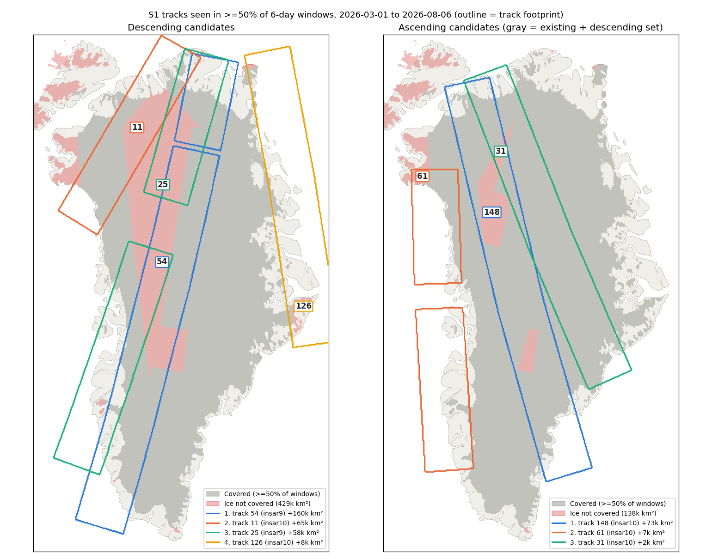
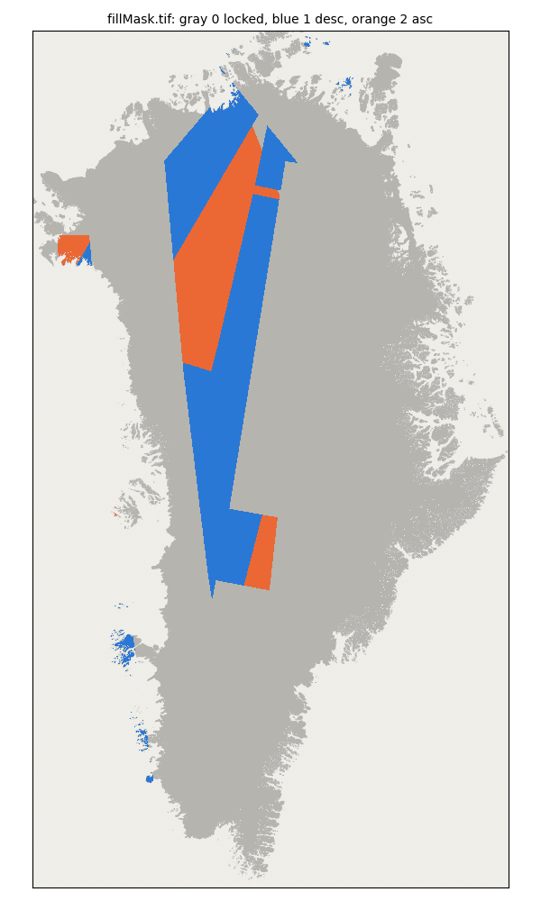
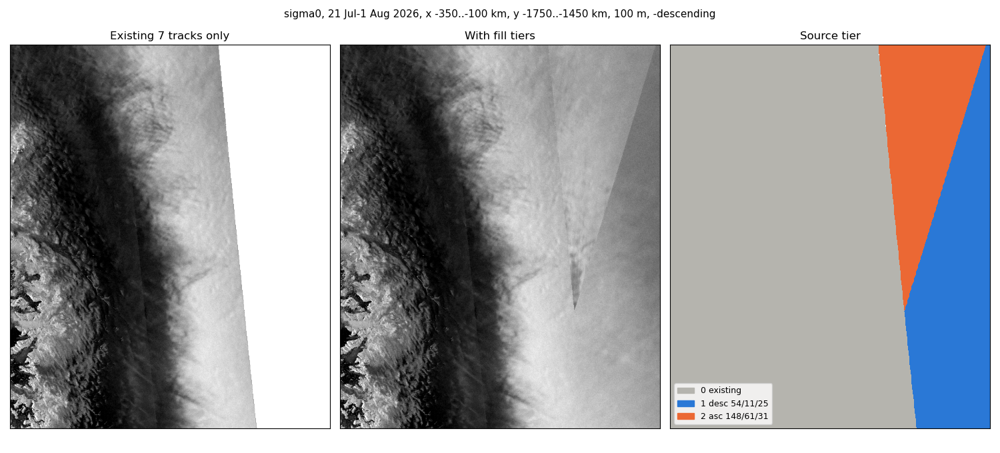

# geomosaic fill tiers (`tier=N`, `-fillMask`)

Implemented 2026-11-11 and enabled in both S1 image-mosaic templates
(`/Volumes/insar10/ian/Sentinel1/Release/mosaics/{calibrated,uncalibrated}/mosaic.template.yaml`).

Purpose: fill the interior hole in the S1 image mosaics with tracks that have been acquired
regularly since about March 2026, without changing anything the existing tracks already cover:

1. The 7 existing tracks (`trackOrder: 26 74 90 112 141 170 83`) keep absolute priority.
2. Fill tracks have the lowest priority; descending (54, 11, 25) is above ascending (148, 61, 31).
   Track 126 was left out because it only contributes a coastal patch in the SE.
3. **Coastal glaciers always keep the same geometry.** A fill track never supplies a coastal
   pixel, even in a window where the usual track is missing.
4. No new keys means the output is byte-identical to before.



## Why `trackOrder` alone can't do it

`trackOrder` only filters and orders the input lines. Production runs geomosaic with
`-descending` (`setupimagemosaic.runGeoMosaic`, unless averaging): the first descending input at
a pixel wins, and an ascending input fills only empty pixels. Simply adding the fill tracks would
let descending fill tracks override the existing ascending tracks (74, 90). In average mode it
would blend them in.

## Mechanism

### Tiers (dynamic, per mosaic)

An input line may end with a `tier=N` token, as in `pow geodat gain tier=1`. Tier 0, the default,
is the highest priority. Tiers must not decrease down the list, or the parser errors. An input of
tier t > 0 contributes at a pixel only if:

- no lower tier has valid data there in this mosaic, and
- the `-fillMask` value there is ≥ t.

Within a tier, inputs combine exactly as before, under `-descending`/`-ascending` or averaging.
Orbit priority therefore composes: a fill tier only ever reaches pixels that every lower tier left
empty.

Implementation (`geoMosaic/makeGeoMosaic.c`):

- `tierOwner`, a per-tile `uint8` plane initialised to `NOTIER` (255), records the lowest tier
  that has data at each pixel.
- The pixel loop exits early for a forbidden pixel (`imageTmp = -LARGEINT`, no geocoding or
  RTC), so a rejected pixel costs nothing.
- After the loop, pixels where the input has valid data are claimed for its tier. This uses the
  same test as `geoMosaicScaling`: `> 0`, or `> noData` with `-noPower`.
- An input with no open pixel in its box is skipped before it is read:
  `Skip (tier N: no pixel open to it)`.
- At the end, `tier k: … pixels supplied` is printed per tier. Use it to check a run.

Refused combinations (`geomosaic.c:checkTiers`), each of which has its own rule for which input
wins a pixel: `-nearestDate`, `-nearRange/-farRange`, `-min/-max`, and `-gcov/-geo` (GCOVs are
accumulated after every range/Doppler input, so they would land on top of the fill tiers).

### `-fillMask` (static, frozen raster)

The mask is a Byte GeoTIFF giving the **highest tier allowed** at each pixel. It is sampled at the
output pixel centres in 256-row blocks through `common/iceRockMask.c:sampleMaskFloat()`: any CRS,
nearest neighbour. Off-mask and no-data pixels read as 0. Without `-fillMask` every tier is allowed
everywhere, which gives purely dynamic priority.

| value | meaning |
|---|---|
| 0 | existing tracks only — locked; a missed window leaves a gap, never other geometry |
| 1 | existing, else descending fill |
| 2 | existing, else descending, else ascending fill |

### `mosaicWorkflow/makefillmask.py`

```bash
makefillmask.py calibrated/mosaic.template.yaml fillMask.tif -firstDate 2026-03-01
```

1. For every 500 m cell, compute the fraction of 6-day windows in which each tier acquired it.
   This uses both date DBs (`mosaicTempArgs`, the same ones setupimagemosaic reads) and each
   frame's `geodat10x2.geojson` footprint; within a tier, take the max over its tracks.
2. Set 0 off GIMP ice, where tier 0 covers ≥ `threshold` (0.5), and where no fill tier covers
   ≥ threshold. Everywhere else, set the first fill tier that covers ≥ threshold.
3. Grow each fill region by `-grow` km (default 2) into the locked tier-0 area, but never within
   `-coastBuffer` km (default 30) of the ice margin. Geodat footprints overstate the valid data at
   swath edges by about 1 km. Without growth, a sliver at the hole edge stayed locked to tracks
   that don't fill it; in the test box that left 32,044 pixels empty, against 425 with growth.
   Tier 0 still wins wherever it has data.

The parameters are stored as GeoTIFF metadata. Rebuild the mask only deliberately; the point is
that it stays fixed.

The production mask is `/Volumes/insar10/ian/Sentinel1/Release/mosaics/fillMask.tif`, built
2026-11-11 from 2026-03-01 to 2026-08-06 (27 windows). Of the ice, it locks 1.41 M km², allows
descending fill on 0.25 M km² and ascending fill on 0.12 M km².



## Python plumbing

- Template keys: `fillTrackOrder` is a list of lists, one per tier, written after `trackOrder`.
  `fillMask` is an absolute path. Both are absent by default.
- `mosaicfunc.sarDateRange.printPowInputFileImages(..., fillTrackOrder=None)` appends
  ` tier=N`. `makeSectionedPowerInputFiles` passes `mTemp.get('fillTrackOrder')`.
- `setupimagemosaic.py` adds the fill tracks to the DB selection and adds `-fillMask` via
  `geoMosaicExtraFlags`. It errors on a repeated track, on `trackOrder: '*'`, and on corr mosaics.
- `bin/makeimageshapefile.py` accepts the 4-token power line, so fill products appear in the
  release footprint shapefile.

Backups of the edited non-git files: `setupimagemosaic.py.preFillTiers-20261111`,
`makeimageshapefile.py.preFillTiers-20261111`, and both `mosaic.template.yaml.preFillTiers-20261111`.

## Verification (2026-11-11)

1. **Regression.** I ran the installed geomosaic and the new build on a 80×60 km Jakobshavn box
   (50 m, `-S1Cal`, 17 products, no tiers). sigma0 and gamma0 GeoTIFFs are `cmp`-identical.
2. **Tiers, real data.** Box x −350..−100 km, y −1750..−1450 km, 100 m, 21 Jul–1 Aug 2026, with
   production flags (`-descending -S1Cal`). Input files came from `setupimagemosaic --setupOnly`.
   - A (tier 0 only): 5,314,399 valid pixels.
   - B (+ tier 1) and C (+ tier 2) keep **all 5,314,399 tier-0 pixels bit-identical** in sigma0
     and gamma0.
   - B's added pixels are exactly geomosaic's "tier 1 supplied" count, and C's added pixels are
     exactly its "tier 2 supplied" count.
   - C keeps every pixel of B.
   - Checked against the mask, fill appears only where the mask allows it. The exception is
     pixels whose centres lie exactly on a 500 m mask-cell edge in this test grid, where `floor()`
     after the lat/lon round trip can go either way. The production 50 m/25 m grids sit 25/12.5 m
     off those edges.
   - Runtime is unchanged (C ~44 s vs A).



## Known behaviour

- The fill tracks repeat every 12 days, so in a 6-day mosaic the interior fills in alternate
  windows only.
- Where the mask allows tier 2, descending data still wins in any window that has it. So in the
  orange area the geometry alternates between descending and ascending. That is the requested
  descending-over-ascending priority.
- There is a radiometric step at tier boundaries: different tracks have different
  incidence angles. It is most visible in sigma0.
- Within 30 km of the ice margin, existing coverage between 0% and 50% is only about 1,760 km²,
  so alternating existing/fill geometry at the coast is negligible. Small ice caps that no
  existing track reaches (SW coast, NW near track 61) are filled by a single fill tier
  consistently.
